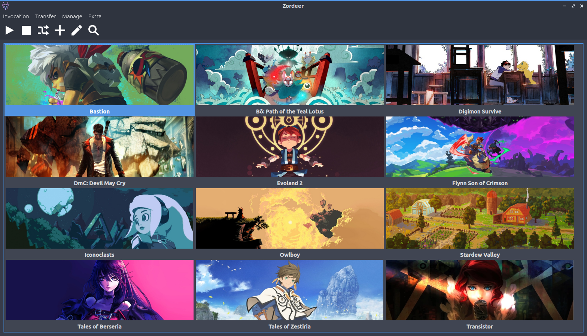

<h1 align="center">

   
  Zordeer
</h1>

  A Qt launcher for games that run via Wine/Proton/UMU

<h1 align="center">

</h1>

  

## Some explanations
- Why was Zordeer created?
  - I wanted a simple Qt launcher, without QML, that would integrate well with LXQt and also be able to fully use the Qt Oxygen style in KDE.
  - I wanted a launcher that would work on Snapd, and Zordeer, being a simple project entirely my own, allowed me to test many things, learn the basics about Wine, Proton, and the Document Portal, as well as the importance of UMU.
- Why does Zordeer create the `$HOME/App/Zordeer` folder?
  - I wanted to use a non-hidden folder for the Zordeer and UMU files.
  - Zordeer also uses the `App/Zordeer` pattern to automatically correct saved paths.
- Is it possible to change the location of the `App/Zordeer` folder?
  - It's possible to use the `ZORDEER_HOME_DIR` environment variable to specify a path.
  - The Flatpak version uses the XDG Base Directory by default, but the `ZORDEER_HOME_DIR` environment variable overrides this.
  - In the Snap version, the `$SNAP_USER_COMMON` folder is used when the home plug is disconnected.
- Where will the UMU used by Zordeer transfer the runtime to?
  - Zordeer uses the `UMU_FOLDERS_PATH` environment variable to change the path that UMU will use; you will find a folder called `UMU` next to the Zordeer folder.
- Regarding paths like `/run/user/1000/doc/`, which are generated by the Document Portal.
  - If this is seen in the `Shortcut manager` after selecting the folders, it's not a problem. But if it appears when selecting an executable or folder, this may prevent execution.
  - If you've selected an installer that doesn't require additional files, it might still work using the Document Portal.
  - If it's an installer that needs files located in the same folder, use the "Run in Prefix" function, selecting the folder where the installer is located; that might work.
- About the toolbar.
  - It is possible to hide the toolbar and use the context menu by right-clicking on the menu bar and unchecking the checkbox that appears.
- Why is the choice of icons different outside of KDE and LXQt?
  - GTK desktop environments like Mate, XFCE, Cinnamon, and Gnome don't have their own platform theme; they use the gtk3 platform theme from Qt itself, but it's very limited. In my tests, this platform theme didn't color symbolic icons.
- Why does only the Flatpak version store files in XDG_CONFIG_HOME and XDG_DATA_HOME? There are two reasons.
  - Flathub would not accept Zordeer because it created a folder in the `$HOME` directory instead of using XDG_CONFIG_HOME and XDG_DATA_HOME.
  - In my tests, Flatpak behaved strangely. When I opened Zordeer without access to the `$HOME` folder, Flatpak tricked Zordeer into thinking it had access. Files were supposedly created somewhere, but they could not be accessed when Zordeer was reopened. Snapd, on the other hand, made it clear that access was denied, but allowed me to detect this and change the folder that would be used instead of preventing Zordeer from opening.
- Why does the shortcut manager require the user to select folders?
  - This was a decision made early in development because I did not know how to handle the Snapd and Flatpak sandboxes, since they modify XDG_CONFIG_HOME and XDG_DATA_HOME.
  - When I tested this idea in Snapd, I realized that, instead of giving a permission error, the Document Portal granted access to the folders and generated paths that Zordeer could write to, giving Zordeer permission to add and remove `.desktop` files at will.
- Why does Zordeer create its own category in the app menu?
  - To avoid cluttering the games category, all the shortcuts created by Zordeer are kept in the same place.
- Can Zordeer be run via CLI?
  - The Zordeer CLI options are limited to three functions: start a specific invocation, start a random invocation, or stop the current invocation.
  - Examples:
    - `zordeer --start-invocation "Bastion"` to start an invocation named Bastion.
    - `zordeer --start-random-invocation` to start a random invocation.
    - `zordeer --stop-invocation` to stop the current invocation.
- Why does Zordeer use SteamGridDB's `hero` style images instead of `grid` style images?
  - Hero-style images are contemplative, leave more room to display the game's name, and avoid the situation where the game cover already shows the name and the interface shows it again.
